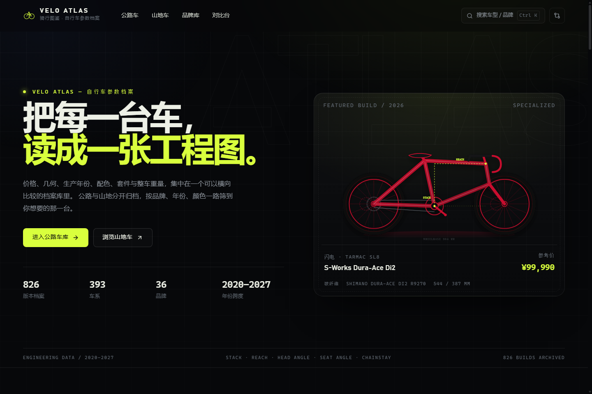

# VELO ATLAS · 骑行图鉴

一个「自行车版懂车帝」式的静态参数档案：把公路车与山地车的**价格、几何、年款、配色、配置与重量**整理成可筛选、可对比、可追溯来源的网站。

**在线访问：<https://eyru.github.io/velo-atlas/>**

- 双板块：公路车 / 山地车各自成册
- 六维筛选：品牌、年份、类型、材质、颜色、价格
- 每台车：六组配置表、完整几何表、价格走势、同车系版本
- 对比台：最多三台并排，28 行逐项对齐并标出最优值
- 数据核查：20 款旗舰 + 16 个国产车系逐项核对，另附 143 个入门版本的价格基线，报告随站发布
- 入门梯队：¥1,999 起的 143 个万元内版本，公路/山地各有独立价格带

## 双击即开（离线单文件）

不想装 Node、不想开服务器时，直接双击：

- [VELO-ATLAS-骑行图鉴.html](VELO-ATLAS-骑行图鉴.html)（项目内）
- [写出/VELO-ATLAS-骑行图鉴.html](../VELO-ATLAS-骑行图鉴.html)（上一级目录副本）

单文件 3.64 MB（3,725,820 字节），CSS、JavaScript、图标、25 张官方配色图与 32 KB 核查报告（含 20 款旗舰、16 个国产车系与 143 个入门版本）全部内联；不请求任何外部资源，断网也能用。筛选、搜索、对比台、几何图与 hash 路由均可正常运行，对比记录保存在浏览器本地。

重新生成：

~~~bash
pnpm build:offline
~~~

## 立即运行

环境：Node.js ≥ 20，pnpm ≥ 9。

~~~bash
pnpm install
pnpm dev        # http://127.0.0.1:5173
~~~

生产构建与本地预览：

~~~bash
pnpm build      # tsc -b && vite build，产物在 dist/
pnpm preview    # http://127.0.0.1:4173
~~~

dist/ 是纯静态产物，可直接部署到任意静态托管。站点使用 hash 路由（#/catalog/road），无需服务器 rewrite。

## 功能地图

| 路由 | 页面 | 主要内容 |
| --- | --- | --- |
| #/ | 首页 | 数据总览、双板块入口、焦点车型、品牌墙、年款索引 |
| #/catalog/road | 公路车档案 | 五组筛选、六种排序、网格/参数表、分页加载 |
| #/catalog/mtb | 山地车档案 | 同上，覆盖 XC / Trail / Enduro / DH / Hardtail |
| #/brands | 品牌库 | 36 个品牌，按车型数量与国别浏览 |
| #/brand/:slug | 品牌页 | 品牌背景、在册车系、年份跨度、价格区间 |
| #/family/:id | 车系页 | 车系故事、配色、尺码、几何图、全部年款版本 |
| #/bike/:id | 整车页 | 参考价、完整度、六组配置、几何、价格走势、相关车型 |
| #/year/:year | 年款页 | 按年份横切全部品牌，支持公路/山地筛选 |
| #/compare | 对比台 | 最多 3 台并排，28 行分组、BEST 标记、打印 |
| #/about | 关于 | 数据维度、术语表、来源与免责声明 |

全局搜索：点击页头搜索框，或按 Ctrl/Cmd + K、/；支持 ↑↓ 选择与 Enter 打开。

## 数据规模

| 指标 | 数值 |
| --- | --- |
| 车系 | 206（公路 114 / 山地 92） |
| 整车版本 | 455（公路 257 / 山地 198） |
| 品牌 | 36（含 XDS / X-LAB / PARDUS / SAVA / WINSPACE / JAVA / TWITTER / 迪卡侬） |
| 年款 | 2020–2026 |
| 公路参考价 | ¥1,999 – ¥118,000 |
| 山地参考价 | ¥1,999 – ¥108,000 |
| 万元以内 | 143 个版本（公路 75 / 山地 68） |
| 配色家族 | 12 类（黑/白/灰/银/红/橙/黄/绿/蓝/紫/金/棕） |

每台整车包含：品牌/车系/世代/年款/版本、中国区与美元参考价、车架/前叉/后避震、套件/轮组/轮胎、座舱、整车重量、配色、完整尺码表、六组规格、价格走势、车系故事与亮点。

入门价格带：公路 ¥5,000 以下 23 个版本、¥5,000–10,000 52 个；山地对应 40 个与 28 个。目录的价格筛选直接按这两档拆分，首页「入门车库」汇总万元内热度最高的 6 台。

## 数据口径与可信度

1. **事实层**：车型名称、车架结构、套件型号、轮组/轮胎规格、几何数据来自品牌官网产品页、技术手册与官方新闻稿。
2. **价格层**：中国区含税建议零售价与主流经销商公开页面，统一标注「参考价」，不构成报价或购买建议；汇率、地区、批次与促销都会造成差异。
3. **重量层**：优先采用品牌公布的整车重量；缺失时按同配置公开数据估算，并在完整度与说明中标注。
4. **核查层**：2026 年 11 月对 20 款公路/山地旗舰逐项核对（官网价 / MSRP、套件、轮组、重量、M 码 Stack/Reach），并补充 16 个国产车系（XDS / X-LAB / PARDUS / SAVA / WINSPACE）的官方产品页来源；站内对应版本已按结果修正。入门梯队（迪卡侬 Triban、XDS RC/英雄、JAVA、TWITTER、各品牌 AL 版本）按品牌官网与授权经销商公开页录入，套件与轮组以原厂配置为准；未逐码公布的几何标注为参考模型。
5. **置信度**：核查报告用 A/B/C 标注，C 级明确写出未核实项，不编造缺失事实。

完整来源、逐车明细、国产车型附录与未核实清单：[public/research/fact-check.md](public/research/fact-check.md)。

本站与任何品牌、经销商无隶属关系。官方产品图仅取自品牌官网或品牌官方 CDN，并在图内标注来源链接；其余车型使用数据驱动的 SVG 侧视图与几何示意图。商标与图片版权归各品牌所有。

## 技术实现

- **栈**：Vite 6 + React 19 + TypeScript 5，自研 CSS 设计系统，lucide-react 图标，无 UI 框架、无后端。
- **设计**：暗色工程蓝图风；--accent #d9ff3d 公路、--mtb #ff7a3d 山地；等宽字体承载数据，大字号承载标题。
- **数据**：src/data/*.ts 为唯一数据源；database.ts 展平车系与版本，派生规格、价格走势、搜索索引与统计。
- **几何图**：GeometryDiagram 依据车架几何实时绘制尺寸线、角度弧与蓝图网格；官方逐码表与参考模型在页面上分开口径。BikeSVG 依据车型类别/行程/轮径绘制侧视图。
- **官方图**：BikeVisualMedia 优先使用品牌官网/CDN 产品图并标注来源，缺图时回退到工程侧视图。
- **状态**：hash 路由 + useSyncExternalStore；对比台存 localStorage（键 velo-atlas-compare，上限 3 台）。
- **响应式**：1440 / 1200 / 1100 / 980 / 760 / 520 断点；移动端菜单、筛选抽屉、表格横向滚动。
- **无障碍与细节**：键盘搜索、可见焦点、aria-expanded、prefers-reduced-motion、打印样式。

目录：

~~~text
src/
  components/   Header Footer Logo BikeCard BikeSVG BikeVisualMedia GeometryDiagram GeoProvenance PriceChart SearchOverlay
  data/         types brands components geometry helpers families-*.ts families-cn.ts database.ts
  lib/          format compare useTitle
  pages/        Home Catalog Brands BrandDetail FamilyDetail BikeDetail YearDetail Compare About NotFound
  App.tsx  main.tsx  router.tsx  styles.css
public/
  favicon.svg  research/fact-check.md
scripts/        数据完整性检查、单文件打包与浏览器 QA 脚本
shots/final/    成品截图
VELO-ATLAS-骑行图鉴.html   离线单文件成品
~~~

## 验证记录

- pnpm build：通过；产物 dist/index.html + 约 70.5 kB CSS（gzip 13.3 kB）+ 约 587.4 kB JS（gzip 162.2 kB）+ 25 张 WebP 官方图。
- 数据完整性：206 车系 / 455 整车 / 18,249 行规格，重复 ID、年份越界、行程缺失、价格/重量、尺码、几何范围、颜色 hex、空规格全部 0 错误。
- 生产预览：公路 257、山地 198、年款页首屏 36 台并可继续加载、8 台入门车详情均为 6 组规格、404 页、核查报告 200，控制台 0 error。
- 交互：目录筛选/排序/加载更多、搜索键盘流、对比增删清空、移动端菜单与筛选抽屉均通过；1440/1024/768/390 无横向溢出。
- 离线单文件：file:// 实测首页 455/206/36、入门车库 6 台与 143 个万元内版本、公路 ¥5,000 以下 23 个/¥5,000–10,000 52 个、山地 40/28、8 台入门车详情均为 6 组规格、X-LAB AD9 官方图与官方逐码几何、AD350 三色切换、关于页署名与 5 个官方资料入口、核查报告 blob 200（23,448 字符，含入门梯队与国产车型附录）、0 console error、0 外部资源请求；1440/1024/768/390 无横向溢出。
- 截图：[首页](shots/final/01-home.png)、[目录](shots/final/02-catalog.png)、[整车页](shots/final/03-bike.png)、[对比台](shots/final/04-compare.png)、[移动端首页](shots/final/05-mobile-home.png)、[移动端目录](shots/final/06-mobile-catalog.png)、[单文件版](shots/final/07-standalone.png)、[X-LAB AD9 官方图与几何](shots/final/08-cn-ad9-official.png)、[关于页署名](shots/final/09-about-signature.png)、[XDS 品牌页](shots/final/10-brand-xds.png)、[AD9 1024 宽](shots/final/11-ad9-1024.png)、[入门车库](shots/entry/home-entry-1440.png)、[单文件首页](shots/entry/offline-home-1440.png)。

## 已知边界

- 年款覆盖 2020–2026，未收录更早的收藏级车型与全部小众品牌。
- 同一年款可能存在多个版本；本站按公开可查的版本建条目，不保证穷尽所有地区配置。
- 价格与重量会随市场与批次变化，购买前请以品牌官方与经销商信息为准。
- 配色中文名为便于检索的意译，不代表官方译名。
- 对比台保存在本机浏览器，不跨设备同步。
